<p align="center">
  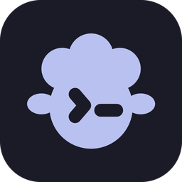
</p>

<h1 align="center">herdrup</h1>

<p align="center">
  <b>Answer your AI coding agents from your phone.</b><br>
  A calm status board for the agents running on your own machine, with a real terminal one tap behind each.
</p>

<p align="center">
  <a href="https://apps.apple.com/app/id6798087089"></a>
  
  
  <a href="LICENSE"></a>
  <a href="https://github.com/themartianapp/herdrup/actions/workflows/ci.yml"></a>
  <a href="https://github.com/themartianapp/herdrup"></a>
  <a href="https://discord.gg/pq7qj4dDqt"></a>
</p>

<p align="center">
  <a href="https://apps.apple.com/app/id6798087089"></a>
  &nbsp;
  <a href="https://herdrup.app"></a>
</p>

<p align="center">
  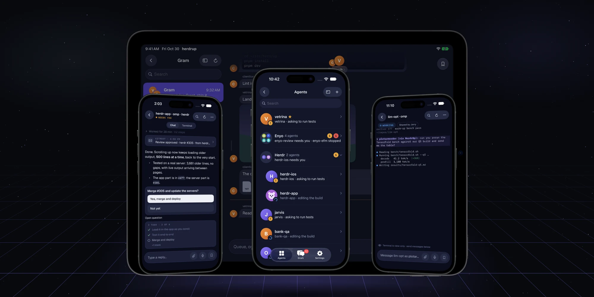
</p>

Your agents keep working after you leave the desk: Claude Code, Codex, omp, Gemini and the rest,
each in a pane of [herdr](https://github.com/jerryfane/herdr) on your own computer. herdrup puts them
in your pocket. When one of them stops to ask something, it turns amber, your phone buzzes, and you
answer with a tap.

It isn't a terminal app that happens to run herdr. herdr's JSON API knows what a pane is and what an
agent is doing, so herdrup shows real objects instead of a grid of characters: who is working, who
is done, who needs you. When you want the raw terminal, it is one tap behind each card.

**Free, open source and private.** There is no herdrup account. Your agents, terminals and chats go
straight between your phone and your own machine over SSH.

---

## Know who needs you

<p align="center">
  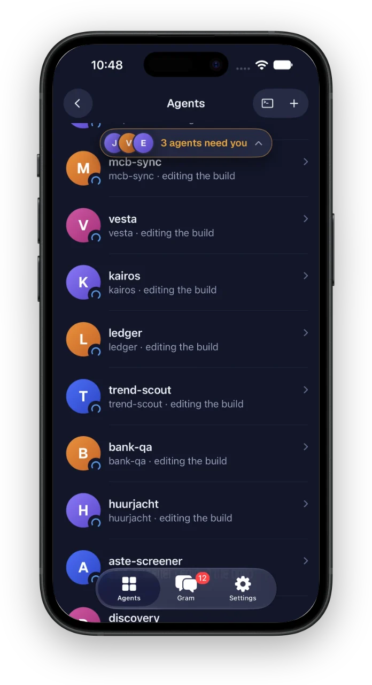
  &nbsp;
  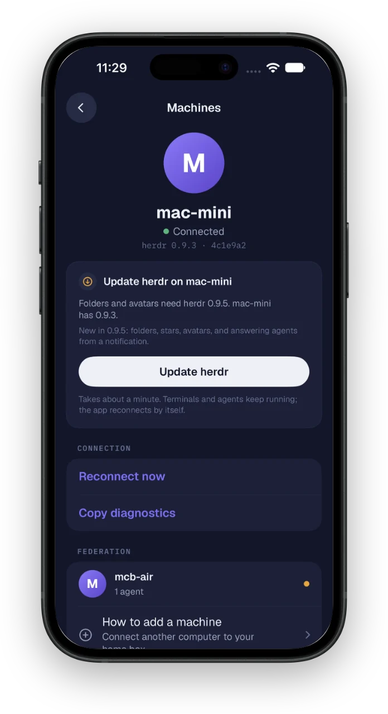
</p>

- **One board for every agent**, sorted by what it needs: *needs you*, *working*, *done*, *stopped*.
  Colour means something: amber is waiting on you, blue is working, green is done, red has died.
- **Live**: on a current herdr, rows change the moment an agent's status does.
- **All your machines**: herdr can federate other computers, and their agents join the same board.
  Machines shows each one, and updates herdr with one button.
- **Away from the app**: a Live Activity on the Lock Screen and in the Dynamic Island shows who needs
  you and for how long, and push notifications ping you when an agent asks. When an omp agent asks a
  question, you can answer it from the notification.

## Talk to your agents

<p align="center">
  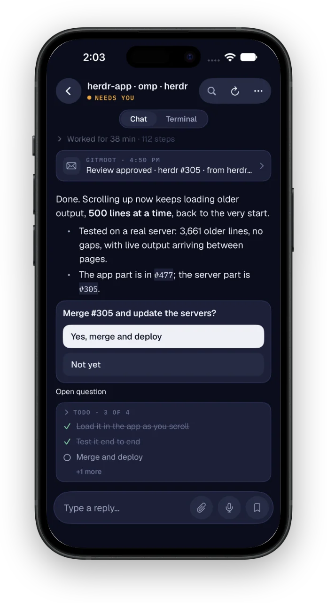
  &nbsp;
  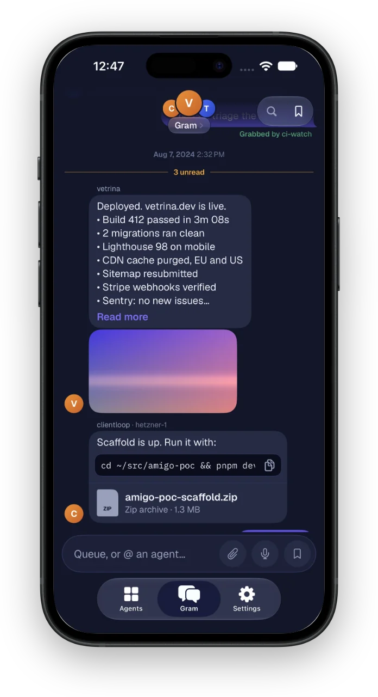
</p>

- **Chat**: an [omp](https://github.com/can1357/oh-my-pi) agent's page opens as a conversation.
  Replies stream in as rendered markdown with tables, code blocks and Mermaid diagrams. Thinking and
  tool steps fold into one line, and its checklist and running subagents sit in the chat. Flip to
  *Terminal* at any time.
- **Questions and approvals** appear as buttons. Tap one to answer.
- **Gram**: one inbox shared by you and all your agents. They ping you there when they need
  input or have finished something. Send text, dictation, images, videos or files to the shared queue,
  where any agent can pick them up, or @mention one agent.
- **Share to herdrup**: in any app's share sheet, pick an agent and send it a file, a link or some text.

## Answer anything

<p align="center">
  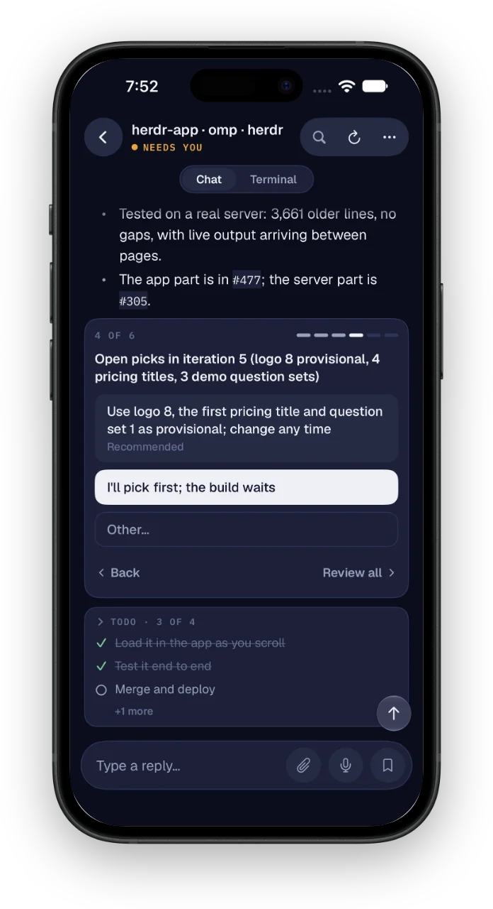
  &nbsp;
  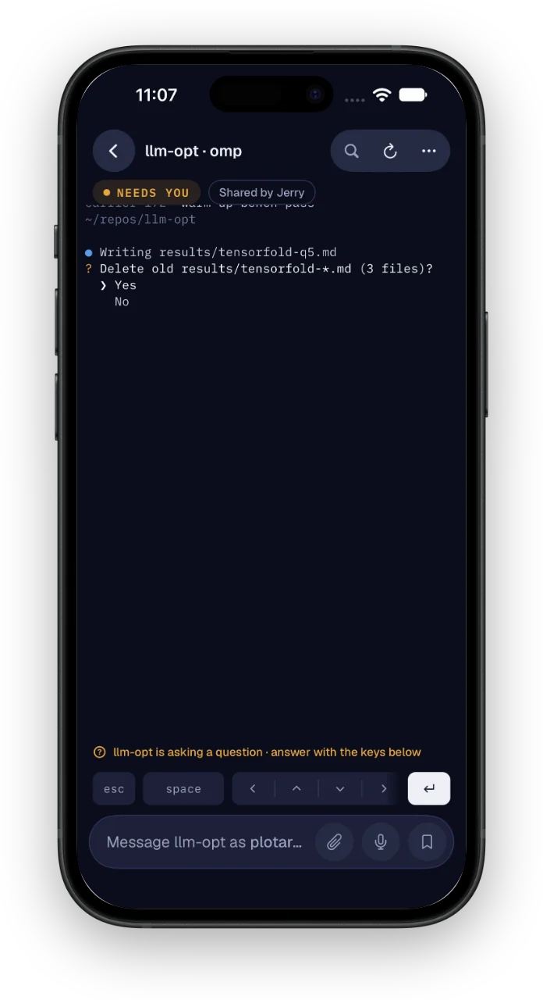
</p>

- **Plans, permission prompts, multi-part questions**: answer them in the chat, or with the menu keys
  (arrows, Tab, Space, esc, Return) right under the terminal while the agent waits.
- *Coming in 1.3.3:* when omp asks several questions in one form, herdrup steps through them one at
  a time, marks the recommended answer, and lets you review everything before you submit (left).

## A real terminal

- A full [SwiftTerm](https://github.com/migueldeicaza/SwiftTerm) terminal for every pane, with
  ANSI colour, scrollback and search. Swipe between agents.
- A keys row with esc, Tab, Ctrl and arrows, a composer that grows instead of resizing the agent's
  screen, dictation, and drag-and-drop files on iPad and Mac.
- **Instant typing**: on a slow link, mosh-style local echo shows your keys before the round trip.
  It stays off at a password prompt. **Settings → Typing latency** measures where each key's
  time goes.

## Share an agent with a guest

<p align="center">
  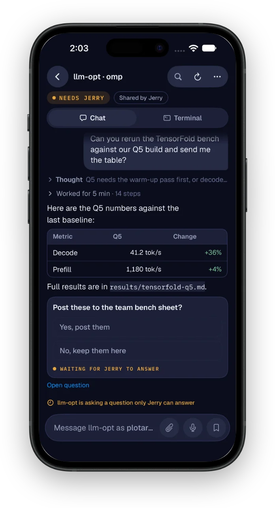
  &nbsp;
  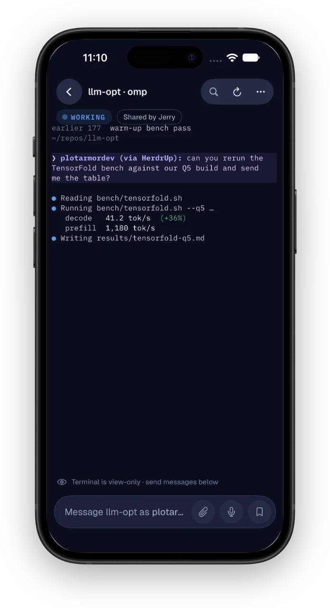
</p>

- From an agent's ••• menu, send a one-use invite as a **QR code or short link**. Your teammate watches the live terminal
  and messages the agent from the herdrup app or **a web browser**, with no account and no SSH access.
- Traffic goes through a relay but is **end-to-end encrypted**, and every message is labelled
  `<name> (via HerdrUp):` in the pane.
- Guests can answer the agent's questions. Nothing else reaches the pane. **Settings → Shared access**
  lists every guest, revokes access and shows an activity log.

## iPhone, iPad, Mac and iPhone Duo

<p align="center">
  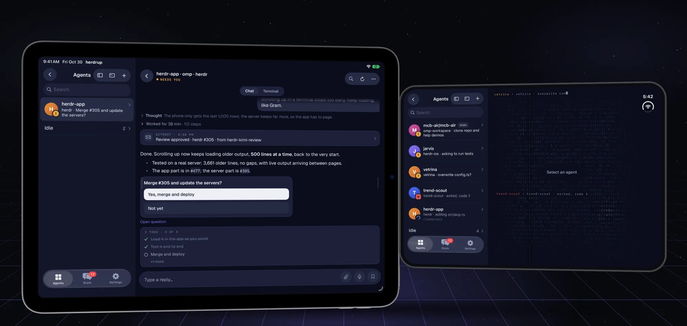
</p>

The iPad gets a sidebar beside the selected agent, a resizable chat column, keyboard shortcuts
(⌘K, ⌘F) and pointer hover. The same app runs on Apple Silicon Macs as a Designed-for-iPad app. On
iPhone Duo, the cover screen shows your herd; unfold it and the board and an agent sit side by side.

---

## How it works

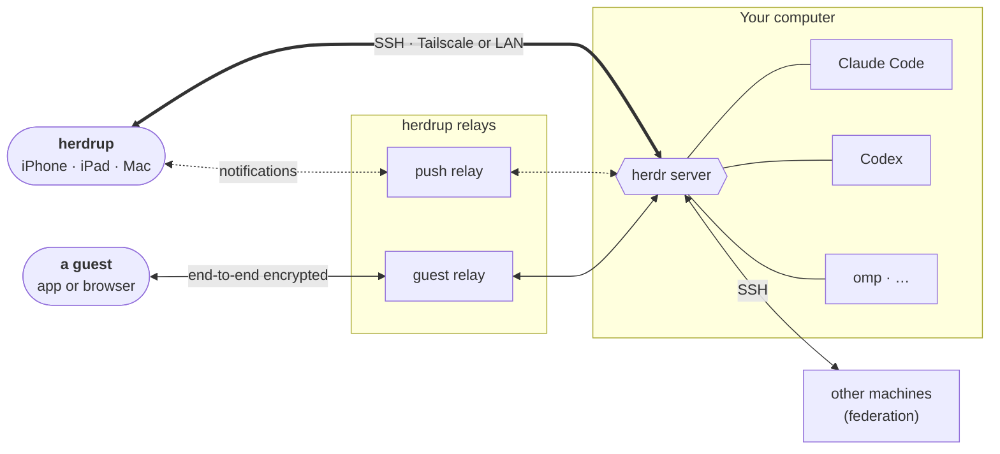

- **Your machine runs [herdr](https://github.com/jerryfane/herdr)**, a terminal workspace that
  runs each coding agent in a pane and knows its state. herdrup needs the herdr fork, which adds
  the Gram, push, chat and live-terminal APIs.
- **The app connects over SSH** (on [Citadel](https://github.com/orlandos-nl/Citadel) and
  swift-nio-ssh, so no libssh is involved) and talks to herdr's JSON API through
  `herdr api-bridge`. The pairing QR carries the machine's SSH host-key fingerprint and a
  one-time token. The phone generates its own key pair and herdr installs the public key, so you
  never type a password.
- **Push** goes through the herdrup push relay, so your machine needs no Apple push key.
  Notification text passes through the relay and is never stored or logged.
- **Guests** never get SSH. A relay carries their end-to-end encrypted traffic to the one agent you
  shared.

## Quick start

**1. On your computer**, install the herdrup fork of herdr, pair, and start it:

```bash
curl -fsSL https://herdrup.app/install.sh | sh   # prebuilt binary, checksum-verified
herdr pair                                         # shows a pairing QR code
herdr                                              # pairing alone doesn't start the server
```

You need [Tailscale](https://tailscale.com) connected on both the phone and the computer (or
`herdr pair --lan` on a private network), and SSH enabled on the computer. On a Mac, that means
turning on **Remote Login**. Upstream herdr (`brew install herdr`, herdr.dev) lacks the APIs
herdrup needs; the app tells you if it finds one.

**2. On your phone**, [get herdrup from the App Store](https://apps.apple.com/app/id6798087089).

**3. Connect.** Tap **Scan pairing code** and point the camera at the QR. Your agents appear.
**Add host** is the manual SSH alternative.

To update herdr later, run the installer again, then restart the server with `herdr server stop`
and `herdr`. Stopping it closes the agents and terminals running in herdr.

### Supported agents

herdr detects **Claude Code, Codex, omp (Oh My Pi), Pi, Gemini, Cursor, GitHub Copilot, OpenCode,
Amp, Droid, Grok, Kimi, Kiro, Cline, Kilo, Qwen, Qoder, Devin, Antigravity, Hermes, Letta,
Mastra Code, Maki and Muse**, and herdrup shows whatever herdr reports. The chat view and
answering from a notification work with omp agents. Every other agent gets the live terminal,
Gram and status.

## Build from source

The Xcode project is generated from [`project.yml`](project.yml) with
[XcodeGen](https://github.com/yonaskolb/XcodeGen); no `.xcodeproj` is committed.

```bash
# The app (macOS + Xcode)
brew install xcodegen
xcodegen generate
xcodebuild -scheme Herdr -destination 'generic/platform=iOS Simulator' build

# The protocol layer, HerdrKit: builds and tests on Linux and macOS
swift build
swift test          # live tests run when a herdr socket + sshd are present; skip otherwise

# The vendored terminal core, also buildable on Linux
swift test --package-path Vendor/SwiftTerm
```

`HerdrKit` (in `Sources/HerdrKit`) contains no UIKit or SwiftUI, so it builds on Linux and runs its
tests against a real herdr server; the iOS app uses it unchanged. The minimums are iOS 17 and
macOS 14 (Citadel needs macOS 14). CI runs the core tests on Linux and UI regressions on iPhone and
iPad simulators.

The full feature reference, the transport's measured protocol facts, the architecture, the
test and CI setup, and the design system are in **[docs/DESIGN.md](docs/DESIGN.md)**.

## Privacy

herdrup has no accounts and no ads, and it does not track you. Your agents, terminals, chats and files
go directly between your devices and your own machines. herdrup's servers handle three things only:
an anonymous daily usage count, notification delivery and guest sharing. None of them stores the
content of your work. Read the [privacy policy](https://herdrup.app/legal/privacy).

## Community

Questions, ideas, screenshots of your herd: join the [Discord](https://discord.gg/pq7qj4dDqt) or
[open an issue](https://github.com/themartianapp/herdrup/issues).

## Credits

herdrup stands on:

- [herdr](https://github.com/jerryfane/herdr), the terminal workspace for coding agents that it is
  a client for
- [SwiftTerm](https://github.com/migueldeicaza/SwiftTerm) by Miguel de Icaza, vendored in
  [`Vendor/SwiftTerm`](Vendor/SwiftTerm) with local changes
- [Citadel](https://github.com/orlandos-nl/Citadel) and
  [swift-nio-ssh](https://github.com/apple/swift-nio-ssh), the pure-Swift SSH stack (through
  [a fork](https://github.com/jerryfane/swift-nio-ssh))
- [Mermaid](https://github.com/mermaid-js/mermaid) (MIT), bundled for diagrams in chat
- [Geist](https://github.com/vercel/geist-font) and [IBM Plex Mono](https://github.com/IBM/plex)
  (SIL OFL), plus symbols from [Nerd Fonts](https://github.com/ryanoasis/nerd-fonts)
- [XcodeGen](https://github.com/yonaskolb/XcodeGen)

## License

[Apache-2.0](LICENSE). Apple, the Apple logo, iPhone and iPad are trademarks of Apple Inc. App Store
is a service mark of Apple Inc.
